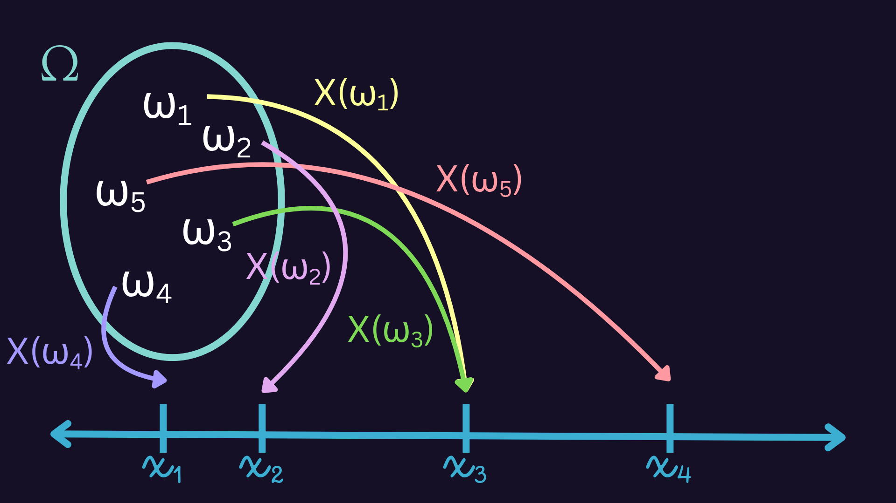
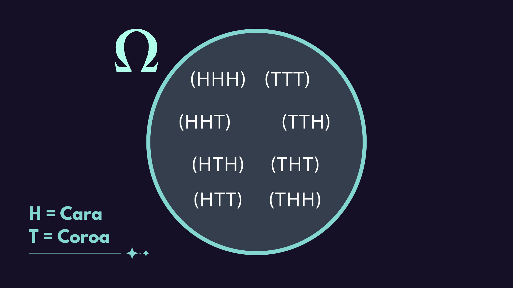
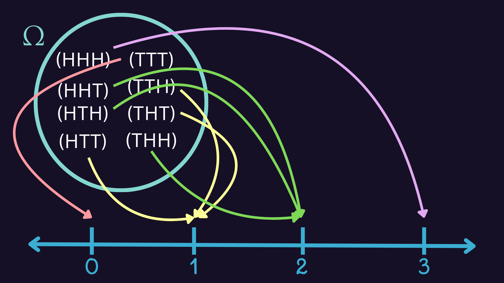

# Probabilidade Básica - Pt. 2

## Variável Aleatória

Vamos considerar que $Ω$ é o conjunto de todos os resultados possíveis para um dado experimento, e cada resultado obtido desse experimento é representado por $ω$.

Uma variável aleatória $X$ é uma **função** que atribui um valor numérico real $x = X(ω)$ a cada resultado $ω ∈ Ω$. Vale lembrar que uma função é uma regra que deve atribuir um valor numérico a todos os elementos de um conjunto, e que dois elementos podem ter a mesma representação numérica.

Formalmente, uma variável aleatória $X$ é uma função real definida no espaço amostral $Ω$, associado a um experimento aleatório.



Para ilustrar esse conceito, vamos a um exemplo.

Imagine que uma moeda é lançada 3 vezes. Então, $Ω$ consiste em $2^3 = 8$ sequências diferentes de 3 caras e coroas, e o espaço amostral pode ser representado da seguinte forma:



E uma variável aleatória (v.a.) $X$ poderia ser definida como: 

```
X = número de caras nos 3 lançamentos
```
Para cada possível sequência $ω$ que consiste de 3 caras e coroas, esta v.a. teria um número $X(ω)$ igual ao número de caras na sequência. Se $ω_1 = (HHT)$, então $X(ω) = 2$.



### Variáveis Aleatórias Discretas

Existem dois tipos de variáveis aleatórias:

- **Discretas:** uma v.a. $X$ cujos valores possíveis constituem um **conjunto finito** ou uma **sequência infinita enumerável**.
- **Contínuas:** uma v.a. $X$ é contínua se o seu conjunto de valores possíveis é um **intervalo de números** (se $A < B$, então qualquer número $X$ entre $A$ e $B$ é um valor possível).

Vamos focar neste primeiro momento nas variáveis aleatórias discretas. O exemplo de $X$ ser o número de caras nos 3 lançamentos de uma moeda é uma v.a. discreta.

### Função de Probabilidade

Dada uma v.a., podemos querer saber a probabilidade de ela assumir um determinado valor. E se quisermos saber a probabilidade de saírem 2 caras nesses três lançamentos? 

Dando uma olhada no nosso espaço amostral, vemos que há 3 resultados possíveis que levam a 2 caras. Como no total temos 8 resultados possíveis para esse experimento, uma conta simples de probabilidade nos fornece:

$P(X=2) = \frac{3}{8} = 0,375$

Ou seja, a probabilidade de que saiam duas caras em três lançamentos de moeda ($X=2$) é de 0,25.

A função que fornece a probabilidade para cada valor possível da variável aleatória é chamada **função de probabilidade** (ou, **distribuição de probabilidades**). No caso das variáveis aleatórias discretas, chamamos de **função massa de probabilidade (f.m.p.)**.

Para uma v.a. discreta $X$, definimos a f.m.p. $p(a)$ de $X$ como:

$p(x) = P\{(X=x\)}$

Importante não confundir: $X$ é a variável aleatória e $x$ é um número.

### Função de Massa de Probabilidade

Quando é especificada uma distribuição de probabilidade em um espaço amostral, pode-se determinar a distribuição de probabilidade para todos os possíveis valores da v.a. $X$.

A f.m.p. $p(a)$ possui as seguintes propriedades:

1. $p(x_i)\geq0$ para $i = 1, 2,...$
2. $p(x) = 0$ para todos os demais valores de $x$

Assim, para nosso clássico exemplo das moedas, a f.m.p. ficaria:

$$
P(X = x) = \begin{cases} 
0,125, & \text{se } x = 0 \text{ ou } x = 3 \\ 
0,375, & \text{se } x = 1 \text{ ou } x = 2 \\ 
0, & \text{caso contrário} 
\end{cases}
$$

Imagino que o caso mais confuso seja a probabilidade 0 para quaisquer outros valores, mas é basicamente imaginar que se você lança três moedas, não tem como saírem mais de 3 caras e nem menos de 0 caras.

Se você notar, a soma das probabilidades para cada valor possível de $X$ resulta em 1, que podemos escrever como:

$\sum_{i=1}^{∞} p(x_i) = 1$

Imagine que você tem uma quantidade 1 (que é a probabilidade do espaço amostral). A função de probabilidade **distribui** essa quantidade (ou essas probabilidades) entre os valores possíveis da variável aleatória.

## Esperança (ou Valor Esperado)

Seja X uma v.a. discreta que assume um conjunto de valores possíveis D e f.m.p. $p(x)$. O **valor esperado** ou a **média da v.a. $X$** denotada por $E(X)$ ou $μ_X$ é:

$E(X) = μ_X = \sum_{x∈D} x * p(x)$

O valor esperado de $X$ é uma **média ponderada** dos possíveis valores que $X$ pode receber, com cada valor sendo ponderado pela probabilidade de que X seja igual a esse valor.

Se $X$ tiver f.m.p. $P(X = 0) = \frac{1}{3}$ e $P(X = 1) = \frac{2}{3}$, então o valor esperado será:

$E(X) = 0 * \frac{1}{3} + 1 * \frac{2}{3} = \frac{2}{3}$

O valor de $x=1$ possui duas vezes mais probabilidade de ocorrer do que $x=0$. Como $E(X) = \frac{2}{3}$, então temos maior **esperança** de que para $X = a$, a probabilidade de $p(a)$ será $\frac{2}{3}$. É como dizermos que nossa intuição para a probabilidade nas condições desse experimento é a média dos valores, o que pode ser um bom chute se não tivermos condições de calcular a probabilidade desse valor.
